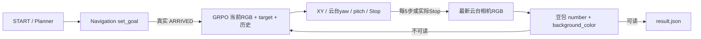

# G1 单巡检点：导航 → GRPO 云台视角 → 豆包读数

这是从现有工程实际提取的独立待发布目录。**发布范围：封装 GRPO 模型及推理、Planner、导航、读数四部分代码。不打包 Isaac Sim 工厂/机器人/云台资产、贴图或步行 ONNX。代码、权重离线推理及 ROS 规划组件已验证；完整 Isaac 巡检闭环尚未验收，不声明真机可用。** 没有停止当前训练，没有重新训练或改动源仓库。

四项功能：既有导航系统、既有单点 Planner/调度、577 SFT 后 GRPO 视觉策略、豆包数字/背景色读取。只支持仿真。无训练入口、无额外相机、无安装云台、无实机 SDK 控制入口。

## 固定模型（本次不重新排名）

- 577 封装：`round11_low_head_replay`，原 `models/va_sft_577_best/checkpoint/best.pt`，SHA256 `cc0550846b94505012bb66ce784ac53a30783ee0829cf1300ad837259875a306`。
- 发布选择：`models/grpo_viewpoint.pt`，对应 `s1_3m_r0001.pt`，SHA256 `6356ea40de6fd02b6988adf751aa6f7f788b4240137ee2aedd6b2e1f95312af8`。
- 该 checkpoint 的 metadata 指向上述 SFT 哈希。本次按用户确认直接沿用已封装版本，不以历史成绩或新接口成绩作为上传门槛，不改权重。
- 历史评测证据只保留在 `docs/model_selection.json` 供追溯，不代表云台 yaw 接口下的效果承诺。当前0–2m训练不纳入，也不干预。
- 完整模型直接加载，无 SFT fallback、LLM、tokenizer 或 adapter。需要本包 DINOv2 源码和权重。

详细证据：[model_selection.json](docs/model_selection.json)、[model_contract.md](docs/model_contract.md)、[migration_inventory.md](docs/migration_inventory.md)。

## 流程与接口



导航拥有身体 yaw。视角阶段不请求导航转向；模型历史 token `BodyYawLeft/Right` 只驱动既有云台 pan ±5°。XY 为原0.3m相对平移，其底层身体 yaw 修正也被禁止。pitch 为原±5°。动作id和网络不变。

Planner 复用实际 `LiveSinglePoint`：READY/START → INIT → NAVIGATING → VIEW_REPRODUCING → READING → SAVING → DONE。真实 Stop 才标记 VIEW_REACHED。每5动作的当前帧若可靠读出数字及背景色，可提前结束（此前已确认的业务行为），不伪造Stop；读数失败最多5次单步重试。超时、导航失败、动作失败、旧帧、API失败均保留失败结果。相似度高/Stop/帧可解析都不等于任务成功。

## 安装并运行离线检查（无需 Isaac、GPU、原项目或 torch hub 缓存）

Linux x86_64，Python 3.11。创建不继承 site-packages 的环境。在本仓库目录：

```bash
python3.11 -m venv .venv
.venv/bin/python -m pip install torch==2.8.0 --index-url https://download.pytorch.org/whl/cpu
.venv/bin/python -m pip install -e '.[test,reader]'
git lfs install --local
git lfs pull
RELEASE_ROOT="$(pwd)"
cd /tmp
"$RELEASE_ROOT/.venv/bin/g1-inspection" --root "$RELEASE_ROOT" check-models
"$RELEASE_ROOT/.venv/bin/g1-inspection" --root "$RELEASE_ROOT" replay --offline
"$RELEASE_ROOT/.venv/bin/g1-inspection" --root "$RELEASE_ROOT" infer --offline \
  --current "$RELEASE_ROOT/tests/fixtures/current.png" \
  --target "$RELEASE_ROOT/tests/fixtures/target.png" \
  --history '["MoveXPos","BodyYawLeft","GimbalPitchUp"]'
"$RELEASE_ROOT/.venv/bin/python" -m pytest "$RELEASE_ROOT/tests"
```

`--offline` 禁止 Python 网络连接/域名查询；模型只读本地源码/权重。权重缺失、LFS指针、哈希不符立即报错；不下载、不替换模型。DINO官方权重来源为 `https://dl.fbaipublicfiles.com/dinov2/dinov2_vitb14/dinov2_vitb14_pretrain.pth`，本包以 LFS 提供，SHA256 见 manifest。DINO源码原commit unknown，固定已核验树哈希，不擅自更新。

可构建 wheel：`python -m pip install build && python -m build --wheel`。wheel 安装Python运行模块；模型、vendoring、导航源码、配置/fixtures由同版本checkout提供，必须指定 `--root`，不会从工作目录猜路径。不能只拿一个wheel声称包含了场景、GPU仿真或权重。

离线测试fixture为本次生成的合成图，不代表巡检成功。真实原图对迁移回归已在本机运行，照片未公开打包，数值证据见 `docs/real_image_*json`。

## 仿真、导航、API 的必要外部条件

- Isaac Sim **5.0.0.0**；Isaac Lab源码 `46dff135f44683f031edf346e544fcfd8456b2bb`（v2.2.0，发行包isaaclab 0.44.9）。官方仓库 `https://github.com/isaac-sim/IsaacLab.git`。需要兼容 NVIDIA GPU/驱动及相机渲染。不是 Orin 安装要求。
- Unitree SDK2 Python `65691c8a8bc53b98d3976dba4dbf9d5d20b2e7f5`：`https://github.com/unitreerobotics/unitree_sdk2_python.git`。
- CycloneDDS `5041f3560c088c99e5088b2b8520b69169621196`：`https://github.com/eclipse-cyclonedds/cyclonedds.git`。Python binding0.10.2，显式设置 `CYCLONEDDS_HOME`。仿真 DDS 限loopback，导航 ROS子进程单独使用FastDDS。
- Ubuntu 22.04 / ROS2 Humble / colcon / PCL、rclcpp、tf2、pcl_conversions、sensor_msgs_py。ROS `/usr/bin/python3` 与仿真 Python3.11 分开。
- 有权限使用的工厂、G1资产闭包、实际步行 `policy.onnx`、当前目标截图；来源/实际SHA256见 `resources/external_manifest.json`。
- NVIDIA内置 MDL 模块 `OmniPBR.mdl`、`OmniGlass.mdl`、`OmniSurface.mdl`、`gltf/pbr.mdl` 由Isaac Kit提供。源场景独立usd-core检查仅这些模块未解析，不误写成纹理全部缺失。需要在Kit中验证渲染。
- 原 GroundPlaneCfg 仍依赖平台 `ISAAC_NUCLEUS_DIR/Environments/Grid/default_environment.usd`。必须通过合法的NVIDIA资产安装/可访问官方资源提供，尚未在新环境独立验证。**不宣称完整仿真可断网启动。**
- `ARK_API_KEY` 由环境注入，不写Git；模型ID默认沿用 `doubao-seed-2-1-pro-260915`，需要账号真实可用。当前终端无密钥，因此未验证真实API请求。

实际工作站版本记录：`requirements/simulator-observed.json`。CPU独立环境记录：`requirements/cpu-validated.txt`，不是Orin或Isaac安装锁文件。上述GPU/ROS平台全新安装本轮未执行，不能把CPU安装通过当作仿真安装通过。

## 配置有权使用的资源

`resources/private/` 仅为本机忽略的资源暂存目录，明确不上传、不包含在 Git 克隆中；工厂、机器人、云台、贴图及步行模型均由运行方另行提供。保留资源检查/配置代码与清单，方便对接已有环境；不是交付仿真资产。缺少这些资源时完整仿真任务明确失败，离线视觉推理仍可运行。

在持有原资源的机器上执行（SOURCE_ROOT为包含manifest所列源相对路径的授权资源根）：

```bash
.venv/bin/python -m pip install usd-core==24.11
.venv/bin/python scripts/prepare_private_resources.py \
  --root "$PWD" --source-root "$SOURCE_ROOT" --reader-python "$PWD/.venv/bin/python"
.venv/bin/g1-inspection --root "$PWD" preflight --config "$PWD/configs/mission.local.json"
```

它复制实际USD依赖闭包，不复制源代码/训练数据；生成资源SHA256清单和`mission.local.json`。如果已合法获得同结构的 `resources/private/` 包，在新checkout使用：

```bash
.venv/bin/python scripts/configure_mission.py --root "$PWD" --reader-python "$PWD/.venv/bin/python"
.venv/bin/g1-inspection --root "$PWD" preflight --config "$PWD/configs/mission.local.json"
```

示例配置默认资源为空，必须明确配置后才能启动；不会降级成空场景或假模型。

## 编译导航与完整任务入口

先安装上述外部仿真环境，在该环境安装本包（不可使用CPU版torch覆盖仿真torch）：

```bash
"$SIM_PYTHON" -m pip install -e . --no-deps
bash scripts/build_navigation.sh
```

本工作站 GCC11链接桩与ROS库不一致，若遇`GLIBCXX_3.4.30`错误，本机已验证的显式构建命令为：

```bash
G1_CXX_RUNTIME=/usr/lib/x86_64-linux-gnu/libstdc++.so.6 bash scripts/build_navigation.sh
```

不修改系统库；其他机器先用默认编译。导航C++二进制不入Git，需本机构建。

先等待当前训练结束，不启动第二个Isaac实例。`SIM_PYTHON`指向已配置好Isaac的Python绝对路径，`CYCLONEDDS_HOME`指向上述版本安装根；API密钥只在本地环境配置。

```bash
.venv/bin/g1-inspection --root "$PWD" run \
  --config "$PWD/configs/mission.local.json" --sim-python "$SIM_PYTHON"
```

该命令只执行单点headless任务入口，导航ROS子进程由桥接器启动；模型在同一仿真进程推理，API用配置的独立reader Python。初始化实际READY后，在第二个终端：

```bash
.venv/bin/python scripts/start_mission.py --ready outputs/ready.json --trigger outputs/start.json
```

成功结果在`outputs/single_demo_*/result.json`，包含实际状态转移、动作/执行回读、最新RGB路径及读取结果。例如返回字段（仅格式说明，非本轮实测）：

```json
{"readable":true,"number":10,"background_color":"blue","failure_reason":null}
```

配置/资源缺失会阻止初始化；没有真实ARRIVED不进入视角；执行失败不调用API。完整任务命令已经实现，但本轮因正在运行的训练及API条件未进行真实端到端验收，不能写成通过。

## 验证及发布

详见 [validation_report.md](docs/validation_report.md)、[release_status.json](docs/release_status.json)、[file_tree.txt](docs/file_tree.txt)、[publication.md](docs/publication.md)。原源码/模型逐文件来源在 `docs/source_provenance.json`。已发布到 `https://github.com/chensamjyut/G1` 的 `release/g1-inspection-minimal` 分支，并通过 GitHub 全新克隆、LFS、模型哈希及离线回归验证，详见 `docs/github_delivery_validation.json`。未改变原项目 remote。
